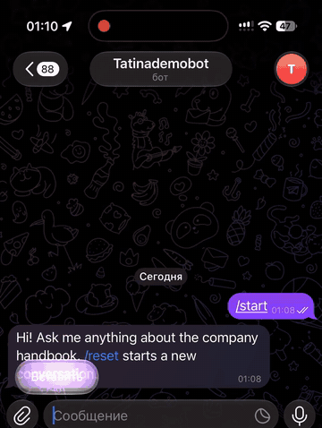
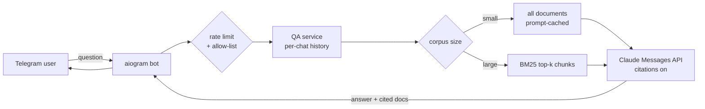

# telegram-llm-bot-template

A Telegram bot that answers questions from your own documents using Claude, and says which document each answer came from.
Drop Markdown or text files into `knowledge/`, set two tokens, and run one Docker command.
It is a small, tested starting point for internal help desks, onboarding bots and customer FAQ bots.

<p align="center"></p>

## How it works



## Stack

Python 3.12 · aiogram 3 · Anthropic Python SDK · pydantic-settings · pytest · Docker

## Key features

- **Answers grounded in your files.** Documents are sent as `document` blocks with citations enabled, so every reply ends with `Sources: travel-policy.md, faq.md`. When the answer isn't in the documents, the bot says so instead of guessing.
- **Two retrieval modes, chosen automatically.**
  - Small knowledge bases (under about 100k tokens) are sent whole and **prompt-cached**, so repeat questions pay about 10% of the input price for the documents.
  - Larger ones are split into overlapping chunks and ranked with **BM25**. There is no vector database to host.
- **Conversation memory** per chat (the last N turns), and `/reset` to clear it.
- **Abuse protection.** A per-user sliding-window rate limit, a maximum question length, and an optional allow-list of Telegram user IDs.
- **Resilient calls.** Server-side model fallback if a safety classifier declines the request. Friendly messages on rate limits or outages. Token usage, including cache reads and writes, is logged with the request ID.
- **Transport-agnostic core.** The same service backs the Telegram bot and a CLI (`python -m app.cli "question"`), so you can test answers without Telegram.

## Run locally

```bash
cp .env.example .env          # add TELEGRAM_BOT_TOKEN and ANTHROPIC_API_KEY
docker compose up --build
```

Without Docker:

```bash
python3.12 -m venv .venv && . .venv/bin/activate
pip install -r requirements-dev.txt
python -m app.cli "How many days do I have to submit a receipt?"
python -m app.bot
pytest -q                     # no network needed, Claude is faked
```

The sample `knowledge/` folder holds a fictional company handbook. Replace it with your own files.

### Configuration

| Variable | Default | Meaning |
|---|---|---|
| `CLAUDE_MODEL` | `claude-opus-5-5` | Model ID |
| `CLAUDE_EFFORT` | `low` | Reasoning effort; raise it for harder questions |
| `FULL_CONTEXT_MAX_CHARS` | `400000` | Above this size, switch from full-context to BM25 retrieval |
| `TOP_K_CHUNKS` | `6` | Chunks per question in retrieval mode |
| `HISTORY_TURNS` | `6` | Turns of chat history kept per chat |
| `ALLOWED_USER_IDS` | empty | Comma-separated Telegram IDs; empty means anyone |
| `RATE_LIMIT_PER_MINUTE` | `6` | Messages per user per minute |

## Project layout

```
app/
  config.py      settings from .env
  knowledge.py   loading, chunking, BM25
  llm.py         request building (citations, caching, fallbacks) and reply parsing
  service.py     per-chat history, Telegram message splitting
  bot.py         aiogram handlers
  cli.py         ask from the terminal
knowledge/       your documents (.md, .txt)
tests/           retrieval, request shape, parsing, history, rate limiting
```

## License

MIT
